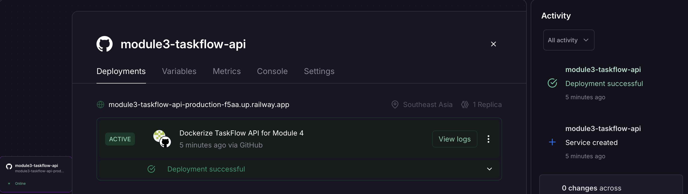
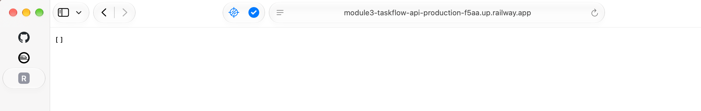

# TaskFlow API

A task management REST API built with Java 21, Spring Boot 4.1.2, Maven, and Spring AI.

Developed as the **Module 3 API project** for the **NTU Advanced Professional Certificate in AI Engineering**, then extended for the **Module 4 End of Module Assignment** with Dockerization, Railway cloud deployment, GitHub Actions CI/CD, and Docker Hub image versioning.

## Module 4 Assignment Submission Summary

Following the [official starter README](https://github.com/aie-devops/taskflow-api#assignment-submission), submit only this GitHub repository URL to NTULearn: https://github.com/zhxunzh84/module3-taskflow-api. The live URL, screenshots, and assignment notes are included in this README.

- **Railway live API:** [GET /api/tasks](https://module3-taskflow-api-production-f5aa.up.railway.app/api/tasks).
- **Existing screenshots:** [Railway dashboard](screenshots/railway-dashboard.png) and [live API response](screenshots/live-api.png); both are displayed in the Deployment Screenshots section below.
- **Core tasks completed:** Dockerization with a multi-stage Dockerfile, local Docker build and container testing, Railway cloud deployment, and verification of the public API returning HTTP 200 with a JSON response.
- **Optional 1 — GitHub Actions CI/CD:** Maven verification, automated Docker builds, and publishing to Docker Hub. See the [workflow](.github/workflows/docker-publish.yml) and [pipeline runs](https://github.com/zhxunzh84/module3-taskflow-api/actions).
- **Optional 4 — Docker image versioning:** Git tag `v1.0.0` and Docker Hub tags `1.0.0`, `latest`, and commit-based `sha-*` tags. See [Docker Hub](https://hub.docker.com/r/zhxunzh84/taskflow-api/tags).
- **Security scanning / Optional 5:** Trivy image scanning has been completed. The workflow saves a JSON scan report and uses `exit-code: "0"`, so a successful workflow does not establish that the image has no vulnerabilities. OWASP Dependency-Check alerts remain unverified; they are not claimed to be resolved or confirmed false positives. No further Optional 5 work is being pursued, and Optional 5 is not claimed as complete.
- **Errors and failures:** No blocking deployment issues were encountered during the verified local Docker build, container startup, or Railway deployment. The unverified OWASP alerts above remain a separate security limitation.

## Overview

TaskFlow API provides basic task management operations, including creating, retrieving, updating, deleting, and marking tasks as completed.

The project follows a layered Spring Boot architecture and includes an optional AI-powered endpoint that generates natural-language summaries of completed and pending tasks.

## Technology Stack

- Java 21
- Spring Boot 4.1.2
- Spring Web / Spring MVC
- Spring AI 2.0.1 with OpenAI
- Maven
- Lombok
- HashMap for in-memory storage
- Postman for API testing

## Project Architecture

The application follows four main layers:

| Layer | Component | Responsibility |
|---|---|---|
| Model | Task | Defines the task data structure |
| Repository | TaskRepository | Manages in-memory task storage |
| Service | TaskService | Implements business logic |
| Controller | TaskController | Exposes REST API endpoints |

An additional TaskSummaryService handles AI-powered task summarization.

## API Endpoints

| Method | Endpoint | Description | Success Status |
|---|---|---|---|
| GET | /api/tasks | Retrieve all tasks | 200 |
| GET | /api/tasks/{id} | Retrieve a task by ID | 200 |
| POST | /api/tasks | Create a new task | 201 |
| PUT | /api/tasks/{id} | Update an existing task | 200 |
| DELETE | /api/tasks/{id} | Delete a task | 200 |
| PUT | /api/tasks/{id}/complete | Mark a task as completed | 200 |
| GET | /api/tasks/summary | Generate an AI task summary | 200 |

Requests for nonexistent task IDs return 404 Not Found where applicable.

## Running the Application

**Prerequisites**

- JDK 21
- Maven
- An OpenAI API key for the optional AI summary functionality

**Configuration**

Set the `OPENAI_API_KEY` environment variable locally before starting the application.

The `application.properties` file references the environment variable using:

`spring.ai.openai.api-key=${OPENAI_API_KEY}`

Never commit an actual API key to source control.

**Start the application**

From the project root, run:

`mvn spring-boot:run`

The API is available at:

`http://localhost:8080`

## Example Request

**Create a Task**

POST `/api/tasks`

Request body:

`{"title":"Learn Spring Boot","completed":false}`

Example response:

`{"id":1,"title":"Learn Spring Boot","completed":false}`

HTTP Status: 201 Created

## AI-Powered Task Summary

The optional Spring AI integration adds:

GET `/api/tasks/summary`

The endpoint retrieves the current task list, sends task information to an OpenAI model through Spring AI ChatClient, and returns a short English summary of completed and pending tasks.

Example response:

"The task 'Learn Spring Boot' is completed. The task 'Complete TaskFlow Assignment' is still pending."

The API key is stored outside the project using an environment variable.

## Testing

The API was manually tested using Postman, covering:

- Task creation
- Retrieve all tasks
- Retrieve a task by ID
- Update an existing task
- Delete a task
- Mark a task as completed
- AI-powered task summarization
- Handling nonexistent task IDs

## Notes

Task data is stored in memory using a HashMap. Data is not persisted across application restarts.

## Assignment

NTU Module 3 — API project; Module 4 — Dockerization, cloud deployment, and CI/CD End of Module Assignment.

**Project:** TaskFlow — Task Management API

## Module 4 — Dockerization & Cloud Deployment

### Deployment Overview

The TaskFlow API has been containerized using a multi-stage Docker build and successfully deployed to Railway.

- **Platform:** Railway
- **Containerization:** Docker (Multi-stage Build)
- **Java:** 21
- **Spring Boot:** 4.1.2
- **Build Tool:** Apache Maven
- **Application Port:** 8080
- **Deployment Source:** GitHub (`main` branch)

### Live Application

**Production API:** https://module3-taskflow-api-production-f5aa.up.railway.app/api/tasks

The endpoint returns a JSON array of tasks. An empty array (`[]`) is expected when no tasks have been created, as the application uses in-memory storage.

### Docker Build and Local Testing

Build the Docker image:

```bash
docker build -t taskflow:latest .
```

Run the container:

```bash
docker run -p 8080:8080 taskflow:latest
```

Verify the API:

```bash
curl -i http://localhost:8080/api/tasks
```

**Local test result:** HTTP 200 OK, with a valid JSON response.

### Railway Deployment

The application is deployed from the GitHub repository using the root-level Dockerfile.

The deployment was verified through the public HTTPS endpoint.

**Production verification:**

```bash
curl -i https://module3-taskflow-api-production-f5aa.up.railway.app/api/tasks
```

**Result:** HTTP 200 OK, `Content-Type: application/json`, response body `[]`.

### Deployment Screenshots

**Railway Dashboard — Successful Deployment**



**Live API — JSON Response**



### Technical Notes

- The Dockerfile uses a multi-stage build with Maven and Java 21.
- The application runs on port 8080.
- Task data is stored in memory and will be reset when the application restarts or redeploys.
- The basic task-list endpoint does not require an OpenAI API call.
- The AI summary endpoint requires a valid OpenAI API key and should not be publicly exposed without appropriate access controls.

### Deployment Issues

No blocking issues were encountered during the verified local Docker build, container startup, or Railway deployment.


## Module 4 — Optional 1: GitHub Actions CI/CD

### Automated Build and Publish Pipeline

GitHub Actions automatically builds, tests, and publishes the TaskFlow API Docker image to Docker Hub.

**Workflow:** [.github/workflows/docker-publish.yml](.github/workflows/docker-publish.yml)

**Pipeline:**

1. Checkout the GitHub repository.
2. Set up Java 21 and Maven dependency caching.
3. Run `mvn --batch-mode verify` as the CI quality gate.
4. Configure Docker Buildx.
5. Authenticate to Docker Hub using GitHub Actions Secrets.
6. Generate Docker image tags.
7. Build and push the Docker image to Docker Hub.

### Workflow Triggers

- Push to the `main` branch.
- Push a Git tag matching `v*`.
- Manual execution using `workflow_dispatch`.

If Maven verification fails, subsequent Docker publishing steps will not execute.

Docker Hub credentials are stored securely in GitHub Actions Secrets:

- `DOCKERHUB_USERNAME`
- `DOCKERHUB_TOKEN`

No Docker Hub credentials are committed to the repository.

### CI/CD Verification

The first automated pipeline was successfully executed for commit `13851d2`.

The workflow completed Maven verification, Docker image building, and publishing to Docker Hub.

**GitHub Actions:** https://github.com/zhxunzh84/module3-taskflow-api/actions

## Module 4 — Optional 4: Docker Image Versioning

### Docker Hub Repository

**Repository:** https://hub.docker.com/r/zhxunzh84/taskflow-api

The Docker image is published with multiple tags for traceability and version management.

| Docker Image Tag | Purpose |
|---|---|
| `latest` | Latest successful build from the main branch |
| `sha-13851d2` | Image associated with Git commit `13851d2` |
| `1.0.0` | First versioned release |

### Versioned Release

An annotated Git tag, `v1.0.0`, was created for commit `13851d2` and pushed to GitHub.

The Git tag triggered the GitHub Actions workflow, which successfully published the Docker image with version tag `1.0.0`.

**Release verification:**

- Git tag `v1.0.0` successfully pushed.
- GitHub Actions release pipeline completed successfully.
- Docker Hub image tag `1.0.0` verified.

### Pull and Run a Versioned Image

```bash
docker pull zhxunzh84/taskflow-api:1.0.0
docker run --rm -p 8080:8080 zhxunzh84/taskflow-api:1.0.0
```

Verify the API from another terminal:

```bash
curl -i http://localhost:8080/api/tasks
```

The expected response for a new in-memory task store is HTTP 200 with JSON body `[]`.
